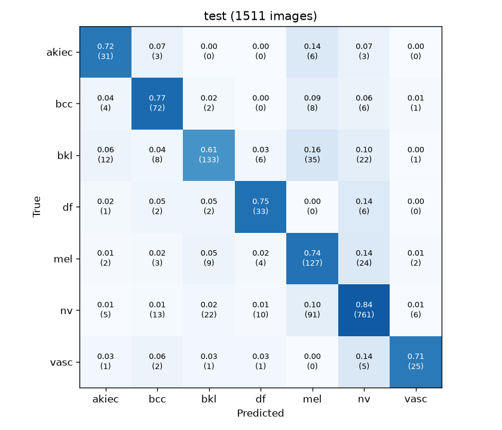

# skin_app

Skin lesion classification from phone photos: a PyTorch training pipeline, a FastAPI inference service and an iOS app (Expo / React Native) that sends a photo and shows the prediction.

> **Research and learning project. Not a medical device and not a diagnostic tool.** Nothing here should be used to make decisions about anyone's health. See a dermatologist about any lesion that worries you or changes.

**Status:** working MVP, end to end (train → evaluate → serve → phone app). The model is a first baseline trained on dermoscopy images; adapting it to real phone photos is the next iteration (see [Roadmap](#roadmap)).

## How it works

```
iPhone (Expo Go app)  ──photo──▶  FastAPI /predict  ──▶  EfficientNet-B0 (PyTorch, GPU)
        ▲                                                        │
        └──────── class probabilities + malignant probability ◀──┘
```

- **Data:** [HAM10000](DATA_LICENSE.md), 10,015 dermoscopy images of 7 lesion types. Train/val split is grouped by `lesion_id` (StratifiedGroupKFold), so images of the same lesion never land in both sets. Evaluation uses the official ISIC 2018 Task 3 test set, which the model never sees during training or model selection.
- **Model:** EfficientNet-B0 pretrained on ImageNet (`timm`), 224 px. Two-phase fine-tuning (frozen backbone warmup, then full fine-tuning), inverse-frequency class weights to handle the 67% nevus imbalance, albumentations augmentation. Everything is driven by YAML configs.
- **Metrics:** balanced accuracy, melanoma sensitivity/specificity, per-class and malignant-vs-benign AUC, confusion matrices. Accuracy alone is misleading here: predicting "nevus" for everything scores 60%.
- **API:** FastAPI service that loads a trained run and returns per-class probabilities, the top class and a malignant probability (mel + bcc + akiec), with a disclaimer in every response. Tested with pytest.
- **App:** Expo Router app (TypeScript). Take or pick a photo, it is resized on the device and sent to the API, and the result screen shows the classes in Spanish with a clear non-diagnostic warning.

## Results

Baseline on the official ISIC 2018 Task 3 test set (1,511 images). Full log in [reports/experiments.md](reports/experiments.md), data analysis in [reports/data_ham10000.md](reports/data_ham10000.md).

| Metric | Value |
|---|---|
| Balanced accuracy (7 classes) | 0.736 |
| Macro AUC | 0.957 |
| Melanoma sensitivity / specificity | 0.743 / 0.896 |
| Malignant vs benign AUC | 0.929 |

Training takes about 10 minutes on an RTX 3060.



Main errors: melanomas classified as nevus (24 of 171 missed), nevi flagged as melanoma (91 of 908), and benign keratosis confused with melanoma. The model starts to overfit after about 10 epochs of full fine-tuning.

## Limitations

- **Domain shift.** HAM10000 is dermoscopy (a magnifying lens pressed on the skin with controlled light). Ordinary phone photos look very different, so the numbers above do not transfer to the app as-is.
- **Skin tone bias.** HAM10000 comes mostly from fair-skinned patients in Austria and Australia. Performance on darker skin is unknown and likely worse.
- **Only 7 classes.** Anything outside them (a rash, a wound, a photo that is not skin) is still forced into one of the 7 classes.
- **Probabilities are not calibrated** and there is no rejection of blurry or invalid photos yet.
- **No trained weights in this repo.** The data is licensed for non-commercial use only, and the model is a research baseline, not something to distribute.

## Roadmap

1. Fine-tune on [PAD-UFES-20](https://data.mendeley.com/datasets/zr7vgbcyr2/1) (smartphone photos) to close the domain gap.
2. Add ISIC 2019/2020 for more data and evaluate fairness across skin tones with Fitzpatrick17k / DDI.
3. Calibrate probabilities (temperature scaling), reject invalid photos, and add Grad-CAM heatmaps.
4. On-device inference (Core ML) so photos never leave the phone.

## Project structure

```
src/vibe_skin/   training, evaluation, metrics, model factory, single-image predictor
configs/         YAML configs for data, training and the API
scripts/         environment check, data preparation and splits
splits/          lesion-grouped train/val split (image and lesion IDs only, no images)
reports/         data report, experiment log, figures
api/             FastAPI service
app/             Expo / React Native app (iOS via Expo Go)
tests/           API tests
```

## Setup

Requires Python 3.12 and [uv](https://docs.astral.sh/uv/). PyTorch is installed with CUDA 12.8 wheels.

```bash
uv sync
uv run python scripts/check_env.py
```

## Data

Download HAM10000 (Harvard Dataverse version, which includes the ISIC 2018 test set and its ground truth) into `datasets/ham10000/`. This folder is ignored by git: no images are included in this repository. See [DATA_LICENSE.md](DATA_LICENSE.md) for the license (CC BY-NC 4.0) and citations.

## Train and evaluate

```bash
uv run python scripts/prepare_data.py                         # splits + data report
uv run python -m vibe_skin.train --config configs/baseline.yaml
uv run python -m vibe_skin.evaluate runs/<run_dir>             # official ISIC 2018 test set
```

Each run writes to `runs/<date>_<name>/`: config, best checkpoint, history, metrics and confusion matrices.

## API

```bash
uv run uvicorn api.main:app --host 0.0.0.0 --port 8000
```

- `GET /health`: model name and device.
- `POST /predict`: multipart upload with field `file` (JPEG/PNG). Returns per-class probabilities, top class and malignant probability (mel + bcc + akiec).
- Interactive docs at `http://<pc-ip>:8000/docs`. The served run is set in `configs/api.yaml`.

The API is meant for a local network only. It has no authentication and should not be exposed to the internet.

Single images from the command line: `uv run python -m vibe_skin.predict runs/<run_dir> photo.jpg`

## Tests

```bash
uv run pytest
```

## Mobile app (Expo, iOS via Expo Go)

```bash
cd app
npm install
npx expo start      # scan the QR code with the iPhone camera, opens in Expo Go
```

The API must be running and reachable from the phone (same WiFi). The default server address is in `app/.env` (`EXPO_PUBLIC_API_URL`) and can be changed in the app's settings screen.

## License

Code: [MIT](LICENSE). The HAM10000 data, and any model trained on it, is under CC BY-NC 4.0 (non-commercial use only); see [DATA_LICENSE.md](DATA_LICENSE.md).
